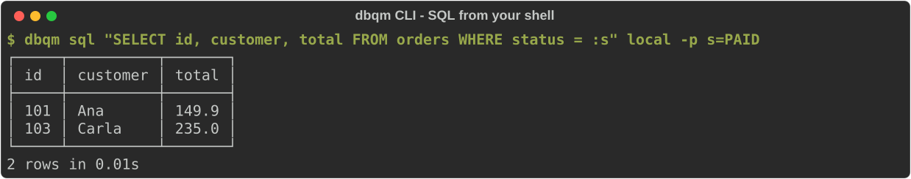
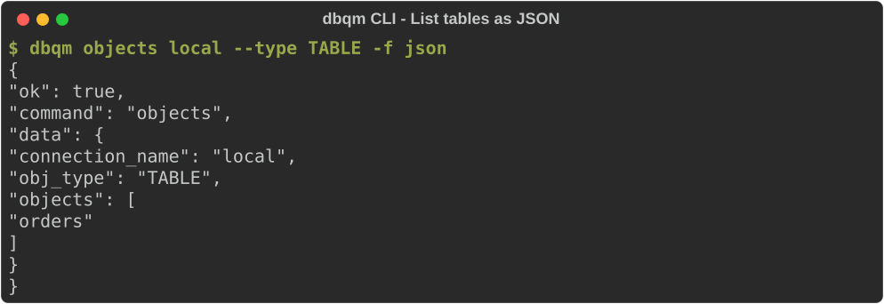
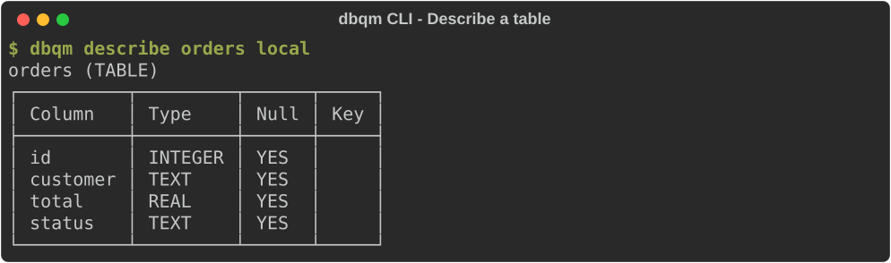
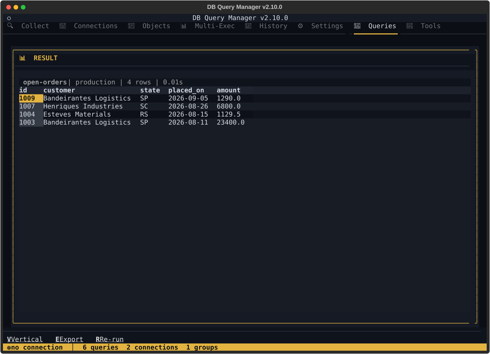
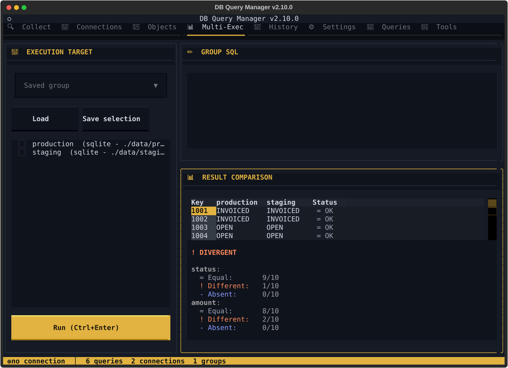

# DB Query Manager (dbqm)

[](https://pypi.org/project/dbqm/)
[](https://pypi.org/project/dbqm/)
[](https://github.com/organizaone/dbqm/actions/workflows/checks.yml)
[](./LICENSE)
[](https://pepy.tech/project/dbqm)

**One tool, five databases, two front ends.** A scriptable CLI and a fullscreen
terminal application for running SQL across **Oracle**, **SQL Server**,
**PostgreSQL**, **MySQL** and **SQLite** — from one place, with one set of
saved connections.

Every operation works without a TTY, so the same tool serves a person at a
terminal, a shell script, a CI job and an AI agent.

```bash
pip install dbqm
```

## One set of connections, five engines

The point of dbqm is that the engine stops mattering. A connection is a name;
the same command, the same flags and the same JSON envelope work against all
five, and the differences that cannot be hidden are listed rather than
pretended away.

| | Oracle | SQL Server | PostgreSQL | MySQL | SQLite |
|---|:--:|:--:|:--:|:--:|:--:|
| Queries, DML, parameters, export | ✅ | ✅ | ✅ | ✅ | ✅ |
| Cross-database comparison | ✅ | ✅ | ✅ | ✅ | ✅ |
| Objects, describe, paged rows | ✅ | ✅ | ✅ | ✅ | ✅ |
| DDL extraction | `DBMS_METADATA` | — | `pg_catalog` | `SHOW CREATE` | `sqlite_master` |
| Execution plans | `DBMS_XPLAN` | — | `EXPLAIN` | `EXPLAIN` | `EXPLAIN QUERY PLAN` |
| Stored routines (`dbqm call`) | ✅ | — | — | — | — |
| Packages and the package editor | ✅ | — | — | — | — |
| Read-only enforced by the server | per transaction | — (dbqm only) | ✅ | ✅ | ✅ |
| Driver needed | Instant Client | bundled | bundled | bundled | none |

The comparison is the reason the list matters: `dbqm multi` runs **one**
statement against connections on **different engines** and reports a per-row
`OK` / `DIFF` / `ABSENT` verdict, exiting `5` when they diverge. Comparing
Oracle production against a PostgreSQL replica is the ordinary case, not a
special one.

## The CLI

Run commands directly from your shell with `dbqm <command>` — no TUI
needed. For example, query a saved connection and get a result table right
in the terminal:

```bash
dbqm sql "SELECT id, customer, total FROM orders WHERE status = :s" local -p s=PAID
```

<p>
  
</p>
<p>
  
</p>
<p>
  
</p>

The captures use a SQLite demo database with a saved connection named
`local`: run SQL, list tables as JSON with
`dbqm objects local --type TABLE -f json`, and inspect columns with
`dbqm describe`. Use your own connection name and SQL; add `-f json` for
structured output instead of a table. Only `dbqm tui` opens the fullscreen
interface.

```bash
# One shape of command per engine. The password is piped, never in argv,
# and the port is the engine's default when you leave it out.
echo "s3cret" | dbqm connection add mssql-prod --type sqlserver \
    --host sql.example.com --database Sales --user sa --password-stdin

echo "s3cret" | dbqm connection add mysql-prod --type mysql \
    --host db.example.com --database shop --user app --password-stdin

# A SQLite file needs nothing but its path — no host, no user, no password.
dbqm connection add local --type sqlite --database ./app.db --no-password

# Run SQL. -f json for a machine, -f raw to pipe a CLOB somewhere else.
dbqm sql "SELECT * FROM orders WHERE status = :s" local -p s=PAID -f json

# Insert a row with bound parameters and explicitly commit the change.
dbqm sql "INSERT INTO orders (id, customer, total, status) VALUES (:id, :customer, :total, :status)" \
    local -p id=104 -p customer=Diana -p total=199.90 -p status=PENDING --commit -f json

# Save a query once, run it with different parameters later.
dbqm run open-orders -p start_date=2026-01-01

# Compare one statement across connections. Exits 5 when they diverge.
dbqm multi "SELECT id, total FROM orders" -c prod -c staging -f json

# See a database's shape without writing catalogue SQL.
dbqm objects prod --type TABLE
dbqm describe orders prod
dbqm rows orders prod --limit 20
```

For larger workflows, execute SQL files, export query results, or compare
Oracle production with a PostgreSQL replica. Connection names, SQL files,
tables and routines below refer to resources you supply.

```bash
# Run a SQL file with parameters and export its result as CSV.
dbqm sql reports/paid-orders.sql local -p status=PAID -e csv -f json

# Compare two engines by order id and save an HTML comparison report.
dbqm multi "SELECT id, total FROM orders" \
    -c oracle-prod -c postgres-replica --key id -e html -f json

# Inspect an execution plan without running the SELECT (Oracle here).
dbqm sql "SELECT * FROM orders WHERE status = :s" oracle-prod -p s=PAID --explain -f json
```

Oracle also supports package procedures, functions and anonymous PL/SQL
blocks. `dbqm call` discovers parameter types and returns OUT parameters in
`data.out_values`, function results in `data.return_value`, and
`DBMS_OUTPUT` lines in `warnings`. Use `--commit` to persist routine changes;
without it, dbqm rolls them back after execution.

```bash
# Call a package procedure and commit its changes.
dbqm call order_pkg.confirm_order oracle-prod -p p_order_id=104 --commit -f json

# Call a package function and read its return value as JSON.
dbqm call order_pkg.customer_total oracle-prod -p p_customer_id=7 -f json

# Standalone procedures use the same command, without the package prefix.
dbqm call refresh_order_summary oracle-prod -p p_customer_id=7 --commit -f json

# Execute an anonymous block and capture DBMS_OUTPUT.
dbqm sql "BEGIN DBMS_OUTPUT.PUT_LINE('Checking order 104'); order_pkg.confirm_order(:id); END;" \
    oracle-prod -p id=104 --commit -f json
```

**Every command but `dbqm tui` runs without a terminal**: no prompts you
cannot answer with a flag, no output you cannot get as JSON. That is what makes
dbqm usable from a script, from CI, or from an agent. The interactive interface
opens with `dbqm tui`; a bare `dbqm`, no arguments, prints the help and exits
0. `dbqm --help` lists every command, grouped by what it is for.

- **One envelope for every command but `tui` and `mcp`.** Success prints
  `{"ok": true, "command": "...", "data": {...}}` on stdout; failure prints
  `{"ok": false, ..., "error": {"code", "message", "exit"}}` on **stderr**,
  leaving stdout empty. Pipe `.data`, never the top level.
- **Exit codes that mean something** — `2` usage or not found, `3` connection
  failed, `4` SQL rejected by the driver, `5` a comparison that diverged. A
  script can branch on the number without parsing text.
- **Passwords never in `argv`** — `--password-stdin` or an environment
  variable, so they stay out of shell history and the process table.
- **It describes itself.** `dbqm describe-cli -f json` reports every command,
  subcommand and flag, read live from the parser rather than from a list
  someone has to remember to update — which is how an agent learns the surface
  without a human writing it down.

Every command, every flag, the envelope and the exit codes:
**[docs/CLI.md](./docs/CLI.md)**.

## Use it from an AI agent

`dbqm mcp` is an [MCP](https://modelcontextprotocol.io) server: it hands the
databases you have configured in dbqm to an AI assistant as a set of tools.
You ask in plain language — *"is `orders` the same in production and
staging?"* — and the assistant lists the connections, reads the schema, runs
the SQL and compares the results itself, instead of you pasting query output
into a chat.

It works with **any client that speaks MCP** — Claude Code, Claude Desktop,
Cursor, VS Code, and the rest. Nothing in it is specific
to one vendor. The server is a second front end over the same code the CLI
calls, so every tool answers with the CLI's own JSON envelope.

### Set it up

```bash
pip install "dbqm[mcp]"
```

Then tell the client how to start the server: a command and its arguments,
the same for every client. This is the entry as Claude Desktop and Cursor
write it in their MCP configuration file:

```json
{
  "mcpServers": {
    "dbqm": { "command": "dbqm", "args": ["mcp"] }
  }
}
```

Claude Code does the same from a command: `claude mcp add dbqm -- dbqm mcp`.
There is no port to open and nothing to keep running — the client starts the
process and it exits when the client disconnects. Where each client keeps that
file, and what to do when `dbqm` is not on the client's `PATH`:
[docs/MCP.md](./docs/MCP.md#configure-a-client).

### What an agent can do

| To | Tools |
|---|---|
| Find out what is configured | `list` (connections, saved queries, comparison groups), `test_connection` |
| Learn a schema | `objects` (tables, views, packages, routines), `describe` (columns, keys, indexes), `ddl` (the source of an object) |
| Look at data | `rows` (a table, paged), `sql` (one statement, with bind parameters; `explain=true` returns the plan) |
| Run what you saved | `run` (a saved query), `run_group` (a saved comparison group) |
| Compare databases | `multi` (one `SELECT` on several connections, compared by a key) |
| See what was run | `history` |

Requests like these need nothing but the server connected:

- *"What columns does `orders` have in `shop-prod`, and which one is the key?"*
  — `describe`
- *"Show me the source of the `order_pkg` package and explain what
  `confirm_order` does."* — `ddl`
- *"How many orders are in each status?"* — the assistant writes the `SELECT`
  and runs it with `sql`
- *"Run the saved query `daily-orders` for 2026-01-31 and summarise it."* —
  `run`, with the date as a parameter
- *"Is the status of every order the same in `shop-prod` and `shop-staging`?"*
  — `multi`
- *"Why is this query slow?"* — `sql` with `explain=true`

The last comparison, as the assistant sends it and as dbqm answers:

```json
{
  "sql": "SELECT id, status FROM orders",
  "connections": ["shop-prod", "shop-staging"],
  "key": "id"
}
```

```json
{
  "ok": true,
  "command": "multi",
  "data": {
    "join_key": "id",
    "all_match": false,
    "comparisons": [
      {
        "column": "status",
        "total_keys": 3,
        "equal_count": 2,
        "diff_count": 1,
        "absent_count": 0,
        "normalized_count": 0,
        "duplicate_rows": {}
      }
    ]
  }
}
```

Three orders, two with the same status on both sides, one that differs. A
comparison that diverges is still `"ok": true` — the run completed, and
`all_match` is what says the databases disagree.

### What an agent cannot do

- **Write, unless you say so.** Every connection is forced read-only, however
  it is stored: a `DELETE` comes back as `{"ok": false, "error": {"code":
  "read_only", ...}}` and never reaches the database. Starting the server with
  `dbqm mcp --allow-write` lets each connection's own read-only flag decide,
  and even then `sql` is the only tool that can write.
- **Reach a connection you did not expose.** `dbqm mcp --connection shop-staging`
  (repeatable) limits the server to the connections named; the others do not
  appear in `list` and cannot be queried.
- **See a password.** Connections are addressed by name. Credentials stay
  encrypted in dbqm's own configuration and are in no tool's answer.

Each tool's parameters, how read-only is enforced on each engine and allowing
or denying individual tools: **[docs/MCP.md](./docs/MCP.md)**.

## The terminal application

```bash
dbqm tui
```



Eight tabs (`F1`–`F8`), in order: collect, connections, objects, multi-exec,
history, settings, queries and tools. On first launch it creates `~/.dbqm/`,
generates an encryption key and walks you through your first connection. Keys,
tabs and the comparison screens: **[docs/TUI.md](./docs/TUI.md)**.



## What it does

**Run and compare**

- **Saved queries** with named parameters, folders, favourites and a value
  mapping for codes that differ between systems
- **Cross-database comparison** — the same logical query against several
  connections, as a table or an interactive HTML report. `dbqm multi` does it
  for one ad-hoc statement, without saving anything
- **Ad-hoc SQL** — SELECT, CTEs, DML with `--commit`, DDL with
  compilation-error detection, and anonymous PL/SQL blocks with `DBMS_OUTPUT`
  captured and shown
- **Execution plans** — `dbqm sql "<query>" <conn> --explain`, in one step
- **Execute routines** — Oracle packages, procedures and functions, with
  parameters in, and OUT values and the return value back as data

**Look around**

- **Object browser** — tables, views and their columns, primary keys, foreign
  keys and indexes on all five engines; routines on the four that have them,
  packages on Oracle
- **Schema discovery from the CLI** — `objects`, `describe` and `rows`, paged
- **DDL extraction** — Oracle, PostgreSQL, MySQL and SQLite (see the table
  above; SQL Server is the gap)
- **Package editor** for Oracle PL/SQL, with inline compilation errors
- **Execution history** with timing, row counts and status

**Curate without the TUI**

- `dbqm connection|query|group|template add|update|show|rm|list` — the same
  validation both front ends use, `-f json` everywhere, `update` changes only
  the flags you pass
- `dbqm config get|set|list` — valid keys and themes are read at runtime, so
  neither list can go stale; a bad value is refused, not coerced
- **Portable configuration** — export and import as an encrypted `.dbqm` bundle

**Stay out of trouble**

- **Read-only connections** — mark one and dbqm declines to send it anything
  but a query, with a one-invocation `--force-write` override for `dbqm sql`
- **Encrypted credentials** — Fernet at rest; passwords read from stdin or the
  environment, never from `argv`
- **Exports** — CSV, JSON, TXT, HTML and SQL, plus IDE-style execution evidence
  (the SQL, the connection, the timestamp, the outcome) for an audit trail
- **Audit logging** — opt-in, append-only JSON
- **English and Portuguese** — every screen, message and `--help` string comes
  from a catalogue; `dbqm config set language pt`, or `DBQM_LANG` for one run

Where dbqm keeps its files, where exports land and which language it speaks:
**[docs/CONFIGURATION.md](./docs/CONFIGURATION.md)**.

## Install

```bash
pip install dbqm
```

Python 3.10+. The drivers come with it, and SQLite needs none — it is in the
standard library. Oracle connections additionally need the Oracle Instant
Client, which dbqm can download for you from Settings › Oracle Instant Client,
or from the CLI with `dbqm oracle-client install`.

If the shell answers that `dbqm` is not a recognized command, the install
worked and the launcher is not on `PATH`: `python -m dbqm tui` runs it anyway,
and [docs/INSTALL.md](./docs/INSTALL.md#dbqm-is-not-recognized-after-installing)
has the permanent fix.

Installing from source, the `win-arm64` caveats and what each dependency is
for: **[docs/INSTALL.md](./docs/INSTALL.md)**.

`pip install "dbqm[mcp]"` additionally installs the MCP server (`dbqm mcp`).

## Security

- Database passwords encrypted at rest using Fernet (`.dbqm_key` master key)
- Configuration bundles use PBKDF2 (480,000 iterations) + Fernet
- Queries use bind variables; SQL identifiers validated against an allowlist
- Query results capped at 10,000 rows; bundle imports limited to 10 MB
- HTML reports escape all user-controlled values
- Audit log files created with restricted permissions
- File open operations restricted to the exports directory

Read-only connections are a rail against mistakes, not a security boundary —
[CHANGELOG.md](./CHANGELOG.md) says what that means and what is deferred.

## Documentation

| | |
|---|---|
| [docs/CLI.md](./docs/CLI.md) | Every command, the JSON envelope, exit codes |
| [docs/MCP.md](./docs/MCP.md) | The MCP server: install, client configuration, tools |
| [docs/TUI.md](./docs/TUI.md) | Tabs, keyboard map, comparison screens |
| [docs/INSTALL.md](./docs/INSTALL.md) | From source, `win-arm64`, dependencies |
| [docs/CONFIGURATION.md](./docs/CONFIGURATION.md) | Data directory, export destination, language |
| [CHANGELOG.md](./CHANGELOG.md) | Release history |
| [docs/ROADMAP.md](./docs/ROADMAP.md) | Known bugs first, then what is planned |
| [docs/ARCHITECTURE.md](./docs/ARCHITECTURE.md) | Layout, layering, patterns, recorded debt |
| [AGENTS.md](./AGENTS.md) | The development workflow, for humans and agents alike |

## License

Copyright (C) 2026 Silvio Chagas.

dbqm is free software: you can redistribute it and/or modify it under the
terms of the [GNU General Public License](./LICENSE) as published by the Free
Software Foundation, either version 3 of the License, or (at your option) any
later version. It is distributed in the hope that it will be useful, but
WITHOUT ANY WARRANTY; without even the implied warranty of MERCHANTABILITY or
FITNESS FOR A PARTICULAR PURPOSE.

In practice: install it and use it anywhere, at work included. If you
distribute dbqm or something built from its code, keep this notice, say what
you changed, and release it under the same license.

Versions up to and including 3.1.2 were released under the MIT License and
remain available under it.
